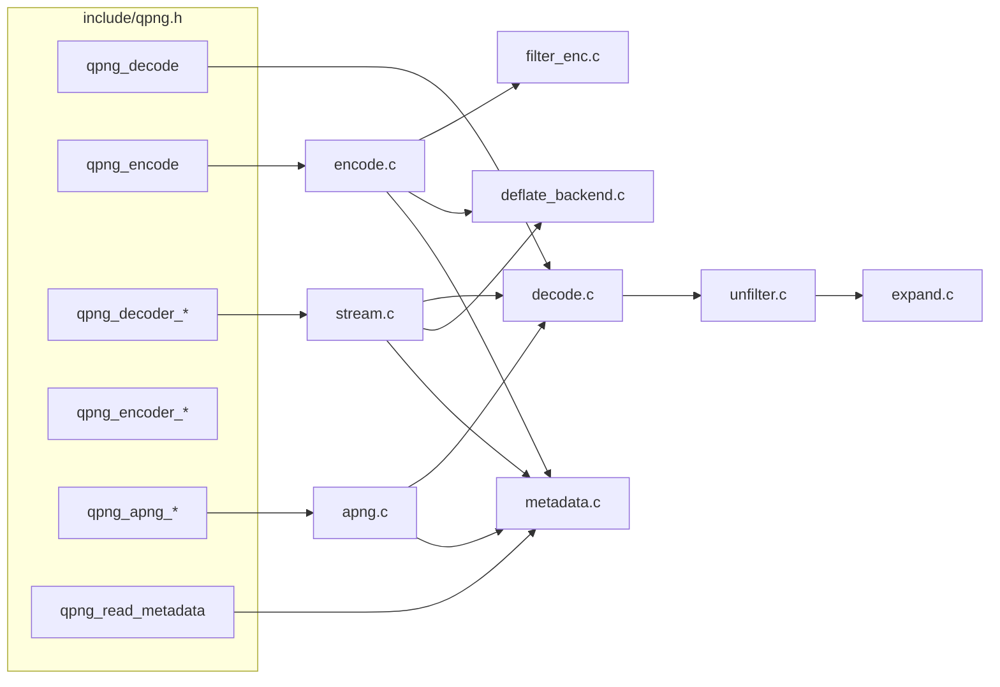

# Architecture

The code is authoritative; this page is the map. Language and ownership rules:
[modern-c.md](modern-c.md).

| path | contents |
|---|---|
| `include/qpng.h` | public API |
| `src/internal.h`, `src/common.c` | shared PNG primitives (signature, IHDR, chunk writers, zlib header, predictors), checked sizes, `qpng__grow`, CPU dispatch, allocators, status strings |
| `src/decode.c` | chunks, limits, fused inflate → unfilter, Adam7 |
| `src/unfilter.c` | scalar / SSE2 / AVX2 unfilter |
| `src/expand.c` | output transforms |
| `src/filter_enc.c` | encoder filters + fused adaptive cost |
| `src/encode.c` | presets, content probe, policy |
| `src/deflate_backend.{c,h}` | libdeflate + zlib-ng |
| `src/metadata.{c,h}` | ancillary chunks |
| `src/stream.c` | streaming decoder / encoder |
| `src/apng.c` | APNG |
| `third_party/*` | vendored; not modernized |
| `tests/`, `fuzz/`, `bench/`, `tools/`, `scripts/` | see README |

Release builds use `-O2` on purpose: CMake's default `-O3` measured 20–30%
slower on the decoder's 2-row wavefront kernels.
