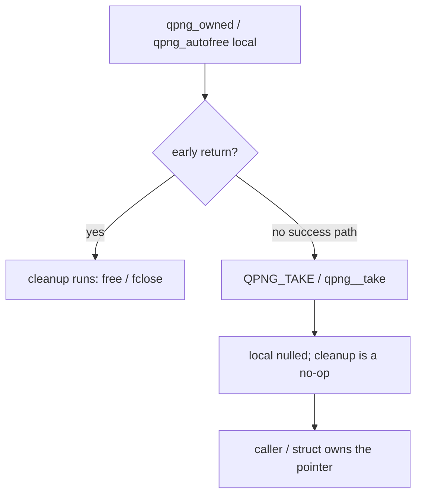

# Modern C decisions and scars

First-party code targets **GNU C2y** with GCC ≥ 16 and Clang ≥ 23. There is no
`gnu23` fallback and sources never probe `__STDC_VERSION__` / `__has_include`.
Dialect is a CMake decision (`qpng_modern_c()`):

`-std=gnu2y -fms-extensions -Wno-microsoft-anon-tag -Wall -Wextra`

Vendored libdeflate (gnu11, `-w`) and zlib-ng (own flags, `-w`) stay isolated.

## Ownership and cleanup

Prefer `[[gnu::cleanup]]` over hand-written `free` / `goto` cleanup. Shared
vocabulary lives in `src/internal.h`:

* `QPNG_CLEANUP(fn)` wraps `[[gnu::cleanup(fn)]]`.
* `qpng_autofree` — libc `malloc` buffers (tools, tests).
* `qpng_owned` — `{ allocator, pointer }` released with `qpng__free`.
* `QPNG_TAKE(var)` / `qpng__take(&owned)` — explicit ownership transfer.

Do not copy a `qpng_owned` (double free). Do not take the address of an owner
past its scope.

## Size arithmetic

Use `<stdckdint.h>` via `qpng__mul_size` / `qpng__add_size` (true on overflow)
instead of open-coded `a * b` checks. `<stdbit.h>` is included for bit queries.

## Array parameters

`T p[static N]` is fine for fixed `N ≥ 1`. **Never** write `T p[n]` /
`T p[static n]` when `n` can be 0: `static` requires nonnull and ≥ N elements,
and a zero-bound VLA parameter is undefined behaviour (UBSan
`-fsanitize=vla-bound` / libFuzzer found this on an empty chunk). Use a plain
pointer when the length may be zero.

## Public header

`include/qpng.h` marks fallible APIs `[[nodiscard]]` (ABI unchanged). Comments
use `nullptr`. The header keeps plain pointer parameters and plain enums so
C++ / pre-C23 consumers keep working; array-parameter notation stays internal.

## Warnings

`-Wall -Wextra` must be clean on the supported compilers. `-Wconversion` /
`-Wsign-conversion` are not enabled yet (~370 diagnostics, mostly
`src/unfilter.c` uint8_t arithmetic); leave that to module rewrites.
