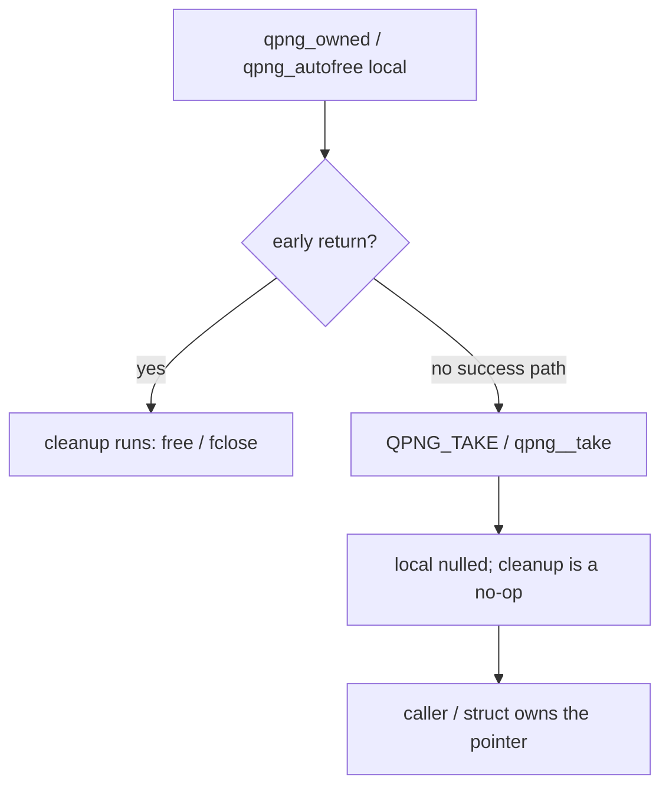

# Modern C decisions and scars

First-party code targets **GNU C2y** with GCC ≥ 16 and Clang ≥ 23. There is no
`gnu23` fallback and sources never probe `__STDC_VERSION__` / `__has_include`.
Dialect is a CMake decision (`qpng_modern_c()`):

`-std=gnu2y -fms-extensions -Wno-microsoft-anon-tag -Wall -Wextra -Wconversion`

Vendored libdeflate (gnu11, `-w`) and zlib-ng (own flags, `-w`) stay isolated.

## Ownership and cleanup

Prefer `[[gnu::cleanup]]` over hand-written `free` / `goto` cleanup. Shared
vocabulary lives in `src/internal.h`:

* `QPNG_CLEANUP(fn)` wraps `[[gnu::cleanup(fn)]]`.
* `qpng_autofree` — libc `malloc` buffers (tools, tests).
* `qpng_owned` — `{ allocator, pointer }` released with `qpng__free`.
* `QPNG_TAKE(var)` / `qpng__take(&owned)` — explicit ownership transfer.

Do not copy a `qpng_owned` (double free). Do not take the address of an owner
past its scope.

## Size arithmetic

Use `<stdckdint.h>` via `qpng__mul_size` / `qpng__add_size` (true on overflow)
instead of open-coded `a * b` checks. `<stdbit.h>` is included for bit queries.

## Array parameters

`T p[static N]` is fine for fixed `N ≥ 1`. **Never** write `T p[n]` /
`T p[static n]` when `n` can be 0: `static` requires nonnull and ≥ N elements,
and a zero-bound VLA parameter is undefined behaviour (UBSan
`-fsanitize=vla-bound` / libFuzzer found this on an empty chunk). Use a plain
pointer when the length may be zero.

## Public header

`include/qpng.h` marks the `qpng_status` enum `[[nodiscard]]` (ABI unchanged), so
one attribute covers every function that returns a status; pure queries such as
`qpng_status_string` and `qpng_backend_available` are not marked. Comments use
`nullptr`. The header keeps plain pointer parameters so C++ / pre-C23 consumers
keep working; array-parameter notation stays internal.

## Warnings

`-Wall -Wextra -Wconversion` (C: implies `-Wsign-conversion`) must be clean on
the supported compilers. Write the cast that spells the conversion the
compiler already did (`(size_t)(2 * ch)`, not `2 * (size_t)ch`) so hot code
compiles identically; check with `objdump -d` before/after.

## One copy of each PNG primitive

Before adding a helper, look in `src/internal.h` / `src/common.c`:

| need | helper |
|---|---|
| signature | `QPNG__SIG` |
| IHDR parse (+ decode limits) / payload | `qpng__parse_ihdr` / `qpng__put_ihdr` |
| chunk in a sized buffer / growable buffer | `qpng__put_chunk` / `qpng__wbuf` (`qpng__wb_*`) |
| zlib CMF/FLG check | `qpng__zlib_hdr_ok` |
| big-endian fields | `be16` `be32` `wbe16` `wbe32` |
| grow an array (allocator has no realloc) | `qpng__grow` |
| encoder option validation | `qpng__check_encode_opts` |
| scalar / SSE2 Paeth | `qpng__pred`, `paeth_s` / `qpng__paeth_epi16` |

## Scars

* `qpng_zcfg` fields are `int`: narrow fields truncated out-of-range user
  levels into valid ones before `qpng__zcfg_valid` could see them.
* Paeth `th` is `(3c - b) - a`: `a` is loop-carried in the unfilter
  wavefronts, keep it last (Clang reassociates either way, don't rely on it).
* Unfilter keeps the 4-byte row-tail store (memcpy is slower), an `int` left
  neighbour in the bpp-1 loops (+2.8 % 8-bit gray) and per-depth palette
  loops in `expand.c` (constant unpack shifts).
* Filter values below `QPNG_FILTER_AUTO` (-1) are rejected (master accepted
  them as AUTO).
* One-shot `qpng_decode` parses IHDR through `qpng__parse_ihdr`, which applies
  the size limits, so an oversized image with a bad IHDR CRC returns
  `QPNG_ERR_LIMITS` where master returned the CRC error. The incremental
  stream decoder still checks the IHDR CRC first.
* The stream encoder (`qpng_encoder_new`) now range-checks `search_depth` and
  `nice_length` like `qpng_encode` (`QPNG_ERR_ARGUMENT`).
