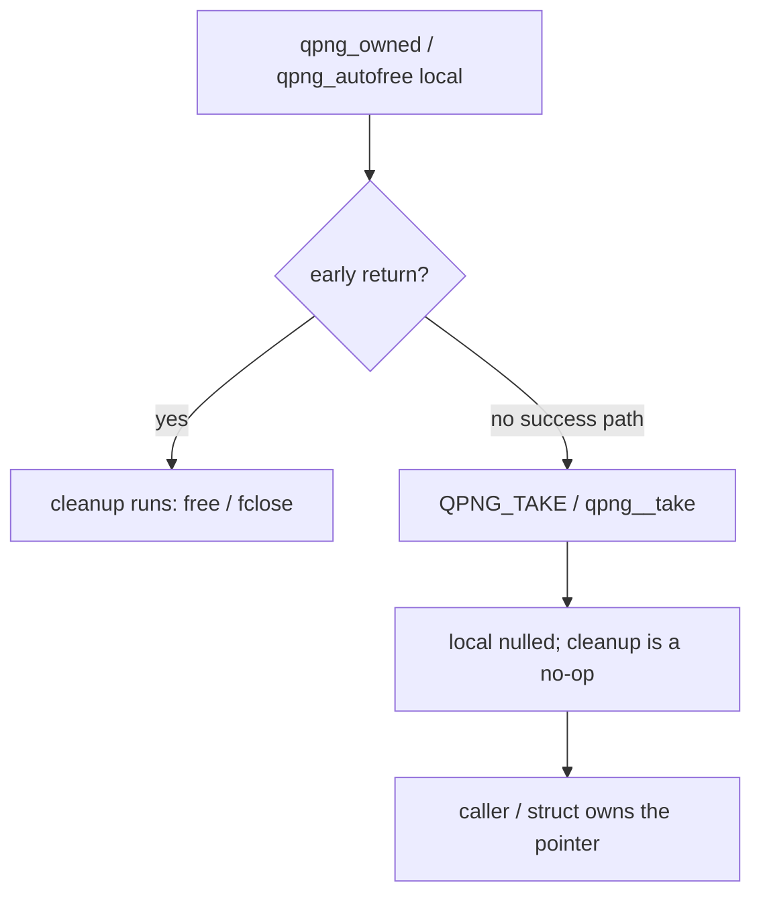

# Modern C decisions and scars

First-party code targets **GNU C2y** with GCC ≥ 16 and Clang ≥ 23. There is no
`gnu23` fallback and sources never probe `__STDC_VERSION__` / `__has_include`.
Dialect is a CMake decision (`qpng_modern_c()`):

`-std=gnu2y -fms-extensions -Wno-microsoft-anon-tag -Wall -Wextra -Wconversion`

Vendored libdeflate (gnu11, `-w`) and zlib-ng (own flags, `-w`) stay isolated.

## Ownership and cleanup

Prefer `[[gnu::cleanup]]` over hand-written `free` / `goto` cleanup. Shared
vocabulary lives in `src/internal.h`:

* `QPNG_CLEANUP(fn)` wraps `[[gnu::cleanup(fn)]]`.
* `qpng_autofree` — libc `malloc` buffers (tools, tests).
* `qpng_owned` — `{ allocator, pointer }` released with `qpng__free`.
* `QPNG_TAKE(var)` / `qpng__take(&owned)` — explicit ownership transfer.

Do not copy a `qpng_owned` (double free). Do not take the address of an owner
past its scope.

## Size arithmetic

Use `<stdckdint.h>` via `qpng__mul_size` / `qpng__add_size` / `qpng__row_bytes`
(true on overflow) instead of open-coded `a * b` checks — `(uint64_t)h * (rowbytes + 1)`
wraps $2^{64}$ on valid 31-bit PNG dimensions. `<stdbit.h>` is included for bit queries.

## Array parameters

Put length parameters before dependent array parameters:

* `T p[static 1]` / `T p[static N]` / `size_t n, T p[static n]` — nonnull with ≥
  stated elements. GCC and Clang elide `if (!p)` at `-O2` and UBSan traps on
  `nullptr`, so omit `static` (`size_t n, T p[n]` or `T *p`) whenever `nullptr`
  is valid or diagnosed at run time (`QPNG_ERR_ARGUMENT`). Opaque incomplete
  structs (`qpng_decoder`, `qpng_zstream`) cannot form array parameters; keep `T *`.
* GCC 16 treats the declared bound as the callee's upper bound too
  (`-Warray-bounds`, `-fsanitize=object-size`): never write `[static 1]` on an
  indexed buffer, spell composite extents honestly (`qpng__put_chunk` takes
  `p[static (size_t)len + 12]`), and keep typed pointers (`uint8_t *`) on
  strided 2D buffers (`stride == 0` means packed) and SIMD kernels that access
  tail padding (`unfilter.c`) or `in[-1]` (`qpng__zstream_write`).
* `n == 0` in `T p[n]` / `T p[static n]` is valid in C2y (adjusted pointer
  parameter, not a VLA object). GCC 16 UBSan accepts it; Clang 23's
  `-fsanitize=vla-bound` falsely instruments parameter bounds, so
  `CMakeLists.txt` disables `vla-bound` on Clang sanitizer builds.
* Keep parameter names identical between prototype and definition when a bound
  expression does arithmetic on them (`3 * (size_t)plen`, `(size_t)h * (n + 1)`),
  otherwise GCC's `-Wvla-parameter` diagnoses a bound mismatch.
* GCC 16 `-fsanitize=address` + `-Wstringop-overread` miscomputes subobject size
  on inlined read-only calls taking `&p->x` (trailing `qpng_xform` through a
  struct pointer) as `const T x[static 1]`; `qpng__xform_row` keeps
  `const qpng_xform *` for that reason.

## Public header

`include/qpng.h` targets GNU C2y directly (`qpng::qpng` and `qpng.pc` propagate
`-std=gnu2y`): no C++ / pre-C23 shims, `[[gnu::visibility("default")]]`,
`constexpr` constants, `bool`, `uint8_t` byte buffers instead of `void *`, and
length-first array parameters. `qpng_status` is `enum [[nodiscard]]` (no
enum-base: GCC 16 rejects `enum [[nodiscard]] : base`), covering every
status-returning function once; pure queries (`qpng_status_string`,
`qpng_backend_available`) are unmarked.

## Warnings

`-Wall -Wextra -Wconversion` (C: implies `-Wsign-conversion`) must be clean on
the supported compilers. Write the cast that spells the conversion the
compiler already did (`(size_t)(2 * ch)`, not `2 * (size_t)ch`) so hot code
compiles identically; check with `objdump -d` before/after.

## One copy of each PNG primitive

Before adding a helper, look in `src/internal.h` / `src/common.c`:

| need | helper |
|---|---|
| signature | `QPNG__SIG` |
| IHDR parse (+ decode limits) / payload / channels | `qpng__parse_ihdr` / `qpng__put_ihdr` / `qpng__channels` |
| PLTE + tRNS header rules / CLI carry-over | `qpng__plte_trns_ok` / `qpng_tool_carry_plte_trns` (`tools/util.h`) |
| row byte width (overflow-checked) | `qpng__row_bytes` |
| chunk in a sized buffer / growable buffer | `qpng__put_chunk` (length-first, `zero_crc` flag) / `qpng__wbuf` (`qpng__wb_*`) |
| zlib CMF/FLG check | `qpng__zlib_hdr_ok` |
| libdeflate decompressor cleanup | `qpng__free_decompressorp` |
| big-endian fields | `be16` `be32` `wbe16` `wbe32` |
| grow an array (allocator has no realloc) | `qpng__grow` |
| encoder option validation | `qpng__check_encode_opts` |
| scalar / SSE2 Paeth | `qpng__pred`, `paeth_s` / `qpng__paeth_epi16` |

## Scars

* `qpng_zcfg` fields are `int`: narrow fields truncated out-of-range user
  levels into valid ones before `qpng__zcfg_valid` could see them.
* Paeth `th` is `(3c - b) - a`: `a` is loop-carried in the unfilter
  wavefronts, keep it last (Clang reassociates either way, don't rely on it).
* Unfilter keeps the 4-byte row-tail store (memcpy is slower), an `int` left
  neighbour in the bpp-1 loops (+2.8 % 8-bit gray) and per-depth palette
  loops in `expand.c` (constant unpack shifts).
* Filter values below `QPNG_FILTER_AUTO` (-1) are rejected (master accepted
  them as AUTO).
* One-shot `qpng_decode` parses IHDR through `qpng__parse_ihdr`, which applies
  the size limits, so an oversized image with a bad IHDR CRC returns
  `QPNG_ERR_LIMITS` where master returned the CRC error. The incremental
  stream decoder still checks the IHDR CRC first.
* The stream encoder (`qpng_encoder_new`) now range-checks `search_depth` and
  `nice_length` like `qpng_encode` (`QPNG_ERR_ARGUMENT`).
